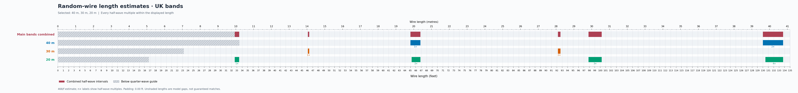
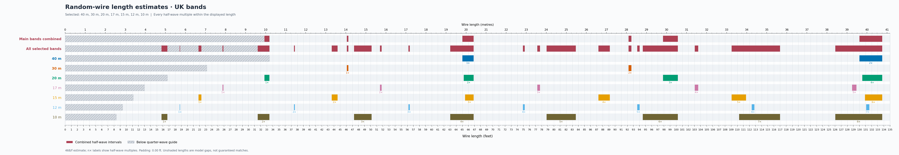

# Improved random-wire calculator

[random_wire.py](random_wire.py) calculates the intervals and makes the chart in
one step. This folder contains the script, numerical tests, dependency list and
generated charts and reports. It can be copied or published on its own.

Charts are **6,000 pixels wide**. The default 135-foot view labels every
**1 foot**, with minor ticks and light grid lines every **0.25 foot**.
The upper metre scale labels every **1 metre**. Open the PNG at full size or
zoom in to read the fine subdivisions; Markdown previews shrink the image.

## Ready-made charts

### Main bands: 40, 30 and 20 m



[Open chart](plots/random-wire-core.png) · [Read length tables](plots/random-wire-core.md)

### Wider selection: 40 through 10 m



[Open chart](plots/random-wire-hf.png) · [Read length tables](plots/random-wire-hf.md)

The first combined row keeps your main 40, 30 and 20 m bands separate from the
combined constraints of all seven selected bands. This lets you see which gaps
are lost when you add 17, 15, 12 and 10 m.

### Occasional 80 m, with 40 through 10 m

[Open chart](plots/random-wire-hf-80.png) · [Read length tables](plots/random-wire-hf-80.md)

80 m uses the UK allocation **3.500–3.800 MHz**. It is optional and is excluded
from the main-band combined row.

## Run it

Requires Python 3.10 or later and Matplotlib. From this folder, create a virtual
environment and install the dependency:

```sh
python3 -m venv .venv
source .venv/bin/activate
python -m pip install -r requirements.txt
```

On Windows PowerShell, use `.venv\Scripts\Activate.ps1` to activate the environment.

Run these commands from this folder:

```sh
# Default: your main 40, 30 and 20 m bands, plotted to 135 feet.
python random_wire.py

# All seven bands from 40 through 10 m.
python random_wire.py --profile hf

# Add occasional 80 m use.
python random_wire.py --profile hf --include-80

# Metres on the main axis; feet on the top axis.
python random_wire.py --profile hf --unit m --max-length 45 --output plots/hf-metres

# Custom selection and an optional 0.5-foot margin on each interval edge.
python random_wire.py --bands 40 30 20 17 --padding 0.5 --output plots/custom-padded
```

Each run writes a PNG, a Markdown report and a JSON data file under `plots/`.
Repeating the same command refreshes those generated files. `--output` supplies
a different filename stem when you want to keep alternative views. Default
outputs are saved in this script's `plots/` folder, even when the script is run
from another directory.

Run the numerical regression checks with `python -m unittest -v`.

## What changed

- Every integer half-wave multiple intersecting the displayed length is included.
  The old length cutoff and six-multiple cap are gone.
- The minimum-length guide derives from the lowest selected frequency. For
  a selection starting at 40 m, it is about **33.43 ft / 10.19 m**, rather than
  the old 10 m setting of 8.36 ft.
- Each band gets a labelled colour row. Combined rows merge overlapping intervals.
- Both feet and metres appear on every chart.
- Reports list all intervals, their multiples, and the gaps for the selected bands.
- Optional padding lets you leave space around the calculated intervals. The
  default is zero, preserving the original formula's boundaries.

## How to interpret it

Colours identify half-wave intervals calculated using the original `468/f`
estimate. Grey hatching marks the quarter-wave minimum-length guide for the
bands in that row. A label such as **3×** means three half-waves.

The [original author's explanation](https://copland.udel.edu/~mm/ham/randomWire/indexOld.html)
describes these intervals as potential high-impedance matching difficulties for
end-fed random wires with typical tuners. They are estimates: installation,
wire insulation, counterpoise and matching equipment affect the result.
Unshaded spans are gaps in this calculation, not guaranteed good antenna lengths.
A deliberate end-fed half-wave with its matching network is a different setup.

UK frequency limits use
[Ofcom OFW611, Tables B/C](https://www.ofcom.org.uk/siteassets/resources/documents/spectrum/emf/emf-amateur-licence-terms-and-conditions.pdf?v=386197),
checked on 3 October 2026. Profiles reflect your preferred bands; the script does
not predict propagation or change selections based on solar conditions.

## Background

The calculation follows the approach in Mike Markowski AB3AP's
[Random Wire Antenna Lengths](https://copland.udel.edu/~mm/ham/randomWire/indexOld.html):
estimate half-wave lengths with `468/f` and identify integer multiples across
selected bands. This Python implementation calculates every multiple within the
chosen display range and plots the bands separately using UK frequency limits.
