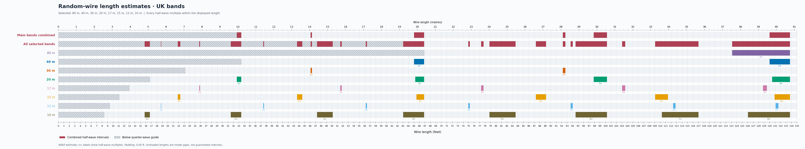

# Random-wire length estimates

Display: **0–135 ft** (0–41.15 m). Padding around half-wave intervals: **0 ft**.

## Bands

| Band | UK range (MHz) | Priority |
|---|---|---|
| 80 m | 3.500–3.800 | Occasional |
| 40 m | 7.000–7.200 | Main |
| 30 m | 10.100–10.150 | Main |
| 20 m | 14.000–14.350 | Main |
| 17 m | 18.068–18.168 | Additional |
| 15 m | 21.000–21.450 | Additional |
| 12 m | 24.890–24.990 | Additional |
| 10 m | 28.000–29.700 | Additional |

Frequency limits: [Ofcom OFW611, Tables B/C](https://www.ofcom.org.uk/siteassets/resources/documents/spectrum/emf/emf-amateur-licence-terms-and-conditions.pdf?v=386197), checked 3 October 2026.

## Reading the chart

Each band has its own colour and row. The combined rows merge its half-wave intervals; the main-band row only combines selected 40, 30 and 20 m bands. Grey hatching shows the original model's quarter-wave minimum-length guide, derived separately from the lowest frequency in each row. This is a guide, not a hard tuning limit.

For all selected bands, that guide is **66.857 ft** (20.378 m).

The calculation uses the original `468 / frequency_MHz` estimate and includes every integer multiple intersecting the display, without the old six-multiple cap. Intervals crossing the right edge are clipped. Labels such as `3×` mean three half-waves.

For an end-fed random wire, these intervals can present high impedances that some tuners cannot match. [Original author's explanation](https://copland.udel.edu/~mm/ham/randomWire/indexOld.html). A deliberate end-fed half-wave with a suitable matching network is a different setup.

## Unflagged spans for all selected bands

These are gaps in this estimate, above the quarter-wave guide. Endpoints touch flagged intervals, so they should not be treated as recommended cut lengths. Installation, wire insulation, counterpoise and matching equipment affect actual behaviour. Optional padding shrinks these spans but does not model those effects.

| Feet | Metres |
|---|---|
| 66.857–74.910 | 20.378–22.833 |
| 75.211–77.279 | 22.924–23.555 |
| 77.706–78.788 | 23.685–24.015 |
| 83.571–87.273 | 25.473–26.601 |
| 89.143–92.217 | 27.171–28.108 |
| 92.673–93.637 | 28.247–28.541 |
| 94.014–94.545 | 28.655–28.817 |
| 100.286–103.038 | 30.567–31.406 |
| 103.609–109.091 | 31.580–33.251 |
| 117.000–123.158 | 35.662–37.539 |
| 133.714–135.000 | 40.756–41.148 |

## Half-wave intervals

Values below exclude optional padding. A † marks an interval clipped at the display limit.

| Band | Multiple | Feet | Metres |
|---|---|---|---|
| 80 m | 1× | 123.158–133.714 | 37.539–40.756 |
| 40 m | 1× | 65.000–66.857 | 19.812–20.378 |
| 40 m | 2× | 130.000–133.714 | 39.624–40.756 |
| 30 m | 1× | 46.108–46.337 | 14.054–14.123 |
| 30 m | 2× | 92.217–92.673 | 28.108–28.247 |
| 20 m | 1× | 32.613–33.429 | 9.941–10.189 |
| 20 m | 2× | 65.226–66.857 | 19.881–20.378 |
| 20 m | 3× | 97.840–100.286 | 29.822–30.567 |
| 20 m | 4× | 130.453–133.714 | 39.762–40.756 |
| 17 m | 1× | 25.760–25.902 | 7.852–7.895 |
| 17 m | 2× | 51.519–51.804 | 15.703–15.790 |
| 17 m | 3× | 77.279–77.706 | 23.555–23.685 |
| 17 m | 4× | 103.038–103.609 | 31.406–31.580 |
| 17 m | 5× | 128.798–129.511 | 39.258–39.475 |
| 15 m | 1× | 21.818–22.286 | 6.650–6.793 |
| 15 m | 2× | 43.636–44.571 | 13.300–13.585 |
| 15 m | 3× | 65.455–66.857 | 19.951–20.378 |
| 15 m | 4× | 87.273–89.143 | 26.601–27.171 |
| 15 m | 5× | 109.091–111.429 | 33.251–33.963 |
| 15 m | 6× | 130.909–133.714 | 39.901–40.756 |
| 12 m | 1× | 18.727–18.803 | 5.708–5.731 |
| 12 m | 2× | 37.455–37.605 | 11.416–11.462 |
| 12 m | 3× | 56.182–56.408 | 17.124–17.193 |
| 12 m | 4× | 74.910–75.211 | 22.833–22.924 |
| 12 m | 5× | 93.637–94.014 | 28.541–28.655 |
| 12 m | 6× | 112.365–112.816 | 34.249–34.386 |
| 12 m | 7× | 131.092–131.619 | 39.957–40.118 |
| 10 m | 1× | 15.758–16.714 | 4.803–5.095 |
| 10 m | 2× | 31.515–33.429 | 9.606–10.189 |
| 10 m | 3× | 47.273–50.143 | 14.409–15.284 |
| 10 m | 4× | 63.030–66.857 | 19.212–20.378 |
| 10 m | 5× | 78.788–83.571 | 24.015–25.473 |
| 10 m | 6× | 94.545–100.286 | 28.817–30.567 |
| 10 m | 7× | 110.303–117.000 | 33.620–35.662 |
| 10 m | 8× | 126.061–133.714 | 38.423–40.756 |

[Full-precision calculation data](random-wire-hf-80.json)
